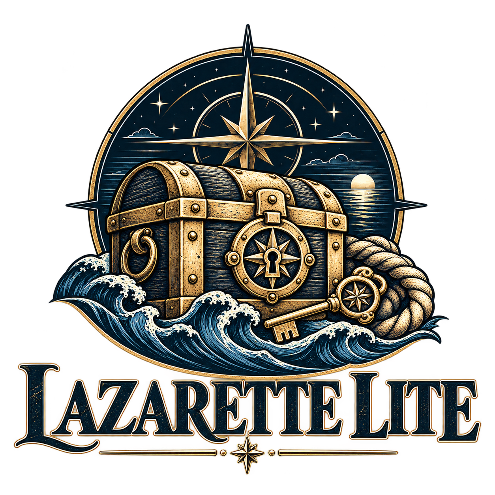

<p align="center">
  
</p>

# Lazarette Lite

Lazarette Lite brings Lazarette's browser experience to Windows Credential Manager. It manages the current Windows user's generic credentials and supplies named secrets to Fleet tools.

## Use it

Double-click `Launch-LazaretteLite.bat`. The browser opens on a private, temporary loopback session. Use `--console` to keep launch diagnostics visible, or `--credential-console` for the terminal credential menu, including metadata-only import and export. Use `--replace` to restart an existing session without a prompt, `--stay` or `LAZARETTE_LITE_AUTO_STOP=0` to keep it alive after the tab closes, and `Stop-LazaretteLite.ps1` to stop it from the shell.

The browser supports searching, favourites for the current session, adding and editing credentials, revealing and copying secrets, password and passphrase generation, and read-only PDF form extraction. PDF.js reads AcroForm and supported XFA fields inside a browser worker. Files and extracted values stay in that tab.

## Fleet demo setup

Create the services the demo tools already expect, then wrap your usual Fleet launcher:

```powershell
.\Start-LiteFleet.ps1 -Launcher C:\Demo\Start-Fleet.cmd
```

The wrapper sets `LAZARETTE_PATH` and `ARC_PATH` for the launch and its children. The `lib\Lazarette.ps1` and `lib\Arc.ps1` loaders support both generations of secret lookup with `-Service` and optional `-User`. The compatibility unlock calls check provider access under the current Windows session. The Lite-specific module exports `Get-LiteSecret` directly.

Custom vault fields and full Lazarette's Fairlead peer API require separate integration.

## Authorization boundary

- Secrets are generic Windows credentials in the current user's store. Windows handles storage and protection. Lite ships no vault engine, encrypted files, or custom vault cryptography.
- The loopback listener binds to `127.0.0.1` on a Windows-assigned port. It checks the process owner's Windows SID, the Host and Origin, a one-time launch token, and a browser session cookie. API responses use `Cache-Control: no-store`.
- Lite makes no outbound requests. The browser assets, PDF worker, fonts, and character maps are served locally. The server stops after Quit or when the browser session goes away.
- Windows PowerShell 5.1 and a browser run the prebuilt app. No admin install or Node runtime is needed on the demo workstation. Sign the PowerShell release files for workstations using `AllSigned`.

Workstation application control and the ISSM's authorization decision still apply.

## Signing

Release scripts are meant to be Authenticode-signed so they run under an `AllSigned` execution policy. This repository contains no certificate and nothing in it is signed. The signing step is scripted but has not been run against a real certificate:

```powershell
# On the release machine, with a code-signing certificate in Cert:\CurrentUser\My, after the final edit:
.\scripts\Sign-Release.ps1 -Thumbprint <thumbprint> -TimestampServer <your timestamp url>
.\scripts\Sign-Release.ps1 -Verify      # exit code 1 unless every script is validly signed
```

- It signs the root and `lib\` scripts (`.ps1`, `.psm1`, `.psd1`), not `tests\` or `scripts\`. The `.cmd` and `.bat` launchers are not checked by PowerShell policy, so they are not signed.
- Any edit after signing, even a line ending, breaks the signature. `.gitattributes` pins line endings so a checkout does not change the signed bytes.
- The timestamp server is the only network use. It happens once on the release machine, never at run time.
- Only `-Verify` and the refusal paths are tested, because there is no certificate to test the signing path with.

## Build

From `ui-src`, run `npm ci`, `npm run check`, and `npm run build`. The runtime serves the generated files in `ui/dist`.

MIT. See [LICENSE](LICENSE).
